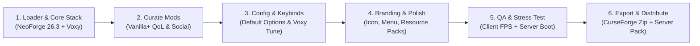

# The Nest Vanilla Edition — Master Rules & Production Workflow

> **Target Version:** Minecraft Java Edition `26.3`  
> **Platform:** CurseForge (`26.3`)  
> **Recommended Loader:** **NeoForge** + Fabric Bridge (**Sinytra Connector** / **Roxy** for **Voxy**)  
> **Identity:** A polished, high-FPS, long-view-distance (`Voxy`) Vanilla+ community modpack.

---

## Part 1: Architectural Decisions (NeoForge vs. Forge & Voxy)

### 1. Why You Should Choose **NeoForge** (Not Legacy Forge) for 26.3
If you are torn between **NeoForge** and **Forge** for Minecraft `26.3`, choose **NeoForge**:
1. **Fabric Bridging Support:** **Sinytra Connector** and **Forgified Fabric API**—the tools that let you run Fabric mods inside a Forge-style modpack—exclusively focus their modern development on **NeoForge**.
2. **Sodium + Voxy Compatibility:** **Voxy** requires **Sodium**'s rendering architecture (it does *not* work with Embeddium). Sodium officially supports **NeoForge** natively on modern versions, making NeoForge the only viable non-Fabric loader where Voxy can work (either via a NeoForge compatibility bridge like *Roxy* / a NeoForge Voxy port, or via *Sinytra Connector*).
3. **Ecosystem Support:** Nearly all major Vanilla+ QoL, optimization, and multiplayer community mods on CurseForge `26.3` publish to NeoForge and Fabric.

---

## Part 2: The 5 Core Rules of "The Nest Vanilla Edition"

To keep the modpack cohesive, fast, and easy to maintain for your community, follow these 5 golden rules:

### Rule 1: The "Vanilla+" Design Filter
Every mod must enhance Vanilla `26.3` rather than replace it:
- **YES:** Performance & LOD (`Sodium`, `Voxy`, `Lithium`, `FerriteCore`), subtle ambiance & visuals (`Sound Physics Remastered`, `AmbientSounds`, `Eating Animation`, `3D Skin Layers`), intuitive QoL (`JEI/EMI`, `Jade`, `AppleSkin`, `Mouse Tweaks`), and community social tools (`Simple Voice Chat`, `Emojiful`).
- **NO:** Heavy industrial tech trees, custom energy systems, overpowered weapons/armor, or cluttered HUD overlays that break the clean Vanilla look.

### Rule 2: Strict Client vs. Server Separation
Because **Voxy** and rendering mods touch low-level OpenGL/Vulkan client code, putting them on a multiplayer server will immediately crash the server on startup.
- Tag every mod in [MODLIST_TRACKER.md](file:///c:/Users/katen/Desktop/Minecraft%20Modpack/MODLIST_TRACKER.md) as `[CLIENT]`, `[SERVER]`, or `[BOTH]`.
- If all your Fabric mods (like Voxy) are client-side only, your **dedicated server remains 100% pure NeoForge**—maximizing server TPS and stability!

### Rule 3: Sodium Only (Never Mix Embeddium with Voxy)
- Voxy hooks directly into **Sodium** internals.
- Never install Embeddium, Rubidium, or OptiFine alongside Voxy.

### Rule 4: Zero-Friction Community Onboarding
Your community members shouldn't have to spend 20 minutes fixing keybinds or video settings on first launch:
- Use **Controlling** so players can search keybinds by key or category.
- Use **Default Options** (or pre-configured `defaultconfigs/`) so the pack boots with:
  - Sensible GUI Scale and FOV
  - Pre-resolved keybinds (zero red conflicts in the Controls menu)
  - Conservative default **Voxy** worker threads & LOD distance (`64`–`128` sections) so laptops and mid-range PCs don't freeze on login, while high-end PCs can crank it up.

### Rule 5: Versioned Releases & Clean Changelogs
- Never overwrite a released `.zip` with the same version number (`1.0.0`, `1.1.0`, `1.1.1`).
- Keep `saves/`, `logs/`, `crash-reports/`, and player authentication data out of CurseForge exports.

---

## Part 3: Step-by-Step Modpack Creation Workflow

### Phase 1: Base Instance & Voxy Prototype (Day 1)
Always test the hardest technical piece (**Voxy on NeoForge 26.3**) *first* in a clean profile before adding 50+ other mods:
1. Open **CurseForge App** -> **Create Custom Profile**:
   - **Profile Name:** `The Nest Vanilla edition (Dev)`
   - **Minecraft Version:** `26.3`
   - **Mod Loader:** `NeoForge` (latest recommended build for `26.3`)
   - **Memory Allocation:** Set profile RAM to `6144 MB` (6 GB) or `8192 MB` (8 GB) in CurseForge Profile Options.
2. Install the **Core Rendering & Bridge Stack** first:
   - `Sodium` (NeoForge `26.3` build — check ImmersiveVFX page for exact recommended Sodium version, e.g. `v0.9.3+`)
   - `ImmersiveVFX` (NeoForge `26.3` build from CurseForge — **do NOT install Iris Shaders**, as ImmersiveVFX has its own built-in shader/shadow pipeline and native Voxy integration!)
   - `Sinytra Connector` + `Forgified Fabric API` (for `26.3`) — *or `Roxy` / native NeoForge Voxy port if available for 26.3*
   - Drop `Voxy` `.jar` into the profile's `mods/` folder.
3. **Launch & Verify:**
   - Boot into a singleplayer test world (`26.3`).
   - Confirm Voxy's LOD menu opens, distant chunks render cleanly beyond vanilla render distance, and **ImmersiveVFX**'s biome fog, pixelated shadows, and water caustics blend seamlessly into Voxy's distant terrain.
   - *Only after this base stack runs smoothly should you proceed to Phase 2!*

### Phase 2: Mod Selection in Batches
Add mods in small thematic batches (5–10 mods at a time) and boot the game after each batch to immediately catch any incompatible Mixin:
- **Batch A — Performance & Stability:** `Lithium`, `FerriteCore`, `EntityCulling`, `ImmediatelyFast`, `ModernFix` (if updated for `26.3`), `Packet Fixer`.
- **Batch B — Information, Map & Inventory QoL:** `Xaero's Minimap (Fair-Play)`, `Xaero's World Map`, `JEI` (or `EMI`), `Jade` (or `WTHIT`), `AppleSkin`, `Mouse Tweaks`, `Controlling`, `Searchables`.
- **Batch C — Community & Multiplayer:** `Simple Voice Chat`, `Sound Physics Remastered`, `Chat Heads`, `Status`.
- **Batch D — Visual Polish & Immersion:** `Presence Footsteps`, `Eating Animation`, `Not Enough Animations`, `3D Skin Layers`. *(Skip separate particle/fog mods like Particular, Falling Leaves, or Visualuality because **ImmersiveVFX** already includes falling leaves, fireflies, ground mist, water foam/caustics, and sky events built-in!)*

### Phase 3: Configuration & Voxy Tuning
1. **Tune Voxy (`config/voxy/`):**
   - Set default ingest/saving threads to `2`–`4` so players with 6-core CPUs don't experience frame drops while moving fast (Elytra / Happy Ghast / Boats).
   - Enable Distant Generation / Server LOD caching if supported by your setup.
2. **Resolve Keybinds:**
   - Open `Options -> Controls -> Key Binds`, filter by **Conflicting**, and unbind (`ESC`) or reassign every overlapping hotkey (especially Voxy's config menu key, Zoom key, Simple Voice Chat keys `V`/`M`, and Shader toggle `K`/`O`).
3. **Lock Default Options:**
   - Use the **Default Options** mod to save your clean keybinds and resource pack order into `defaultconfigs/` so existing players' personal settings aren't wiped on pack updates.

### Phase 4: Branding & Profile Picture
1. Generate and finalize the **"The Nest Vanilla edition"** artwork in `assets/branding/`:
   - **CurseForge Pack Icon:** `1024x1024` `.png` (CurseForge requires at least `400x400`, square `1:1`).
   - **Server List Icon:** Resize a crisp version to `64x64` `.png` named `server-icon.png` for the community server root.
2. *(Optional)* Use **FancyMenu** or **PackMenu** to add *"The Nest Vanilla edition"* logo and a direct **"Join The Nest Server"** button on the title screen.

### Phase 5: Pre-Release QA Checklist
- [ ] **Clean Profile Import Test:** Export the `.zip` and import it as a brand-new profile in CurseForge to verify a fresh player gets every file.
- [ ] **Voxy +Elytra Flyover Test:** Fly in Creative mode at high speed for 3 minutes across new `26.3` biomes; confirm zero crashes and stable frame times.
- [ ] **Dedicated Server Test:** Boot a local server folder containing only `[BOTH]` and `[SERVER]` mods, connect from the client profile, and test `Simple Voice Chat` + `Voxy` LOD saving.

### Phase 6: Exporting from CurseForge (`26.3`)
1. In the CurseForge App, open **The Nest Vanilla edition**, click the **`⋮` (three dots)** menu -> **Share Profile / Export Profile**.
2. Set the version number (e.g., `1.0.0`).
3. In the export file tree, check:
   - [x] `config/`
   - [x] `defaultconfigs/`
   - [x] `resourcepacks/` (only custom/permitted packs)
   - [x] `mods/voxy-*.jar` (check *only* non-CurseForge manual jars so they are bundled into `overrides/mods/`, while all CurseForge-hosted mods go cleanly into `manifest.json`).
4. **Never check:** `logs/`, `crash-reports/`, `saves/`, `screenshots/`, `voxy/` (local player LOD cache folder!), or `usernamecache.json`.
